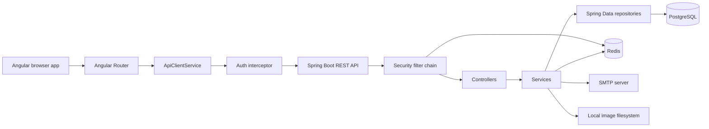
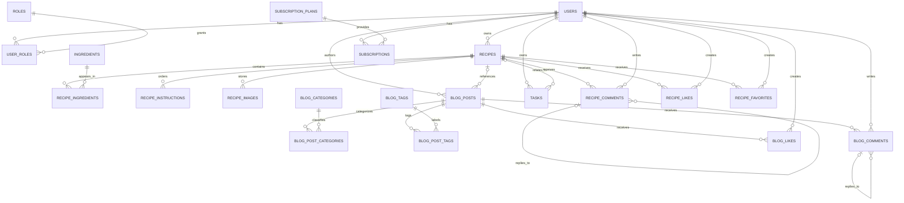
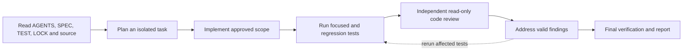

# Recipe Manager

Recipe Manager is a multi-user recipe-management SaaS project. The repository currently contains a Spring Boot backend foundation, PostgreSQL/Flyway schema, Redis-backed authentication and rate limiting, SMTP integration, local image-storage support, and an Angular public/authenticated shell.

> **Repository status:** The current source and [`docs/PROJECT_HANDOFF_REPORT.md`](docs/PROJECT_HANDOFF_REPORT.md) describe an active Version 2 implementation, not a completed production application. The README documents only behavior verified in the repository. Planned or schema-only features are marked explicitly.

## Table of contents

- [Project overview](#project-overview)
- [Technology stack](#technology-stack)
- [Implemented functionality](#implemented-functionality)
- [Project structure](#project-structure)
- [Application architecture](#application-architecture)
- [Database documentation](#database-documentation)
- [REST API](#rest-api)
- [Authentication and security](#authentication-and-security)
- [UI/UX and design system](#uiux-and-design-system)
- [AI agent and subagent workflow](#ai-agent-and-subagent-workflow)
- [Installation and running](#installation-and-running)
- [Environment variables](#environment-variables)
- [Testing](#testing)
- [Development guide](#development-guide)
- [Important project decisions](#important-project-decisions)
- [Troubleshooting](#troubleshooting)
- [Final implementation compliance checklist](#final-implementation-compliance-checklist)
- [Final project summary](#final-project-summary)

## Project overview

### Purpose

The intended product helps people discover, create, organize, and share recipes in a shared cooking workspace. The approved product concept has three areas:

- **Frontoffice:** public recipe, story, creator, pricing, and informational pages.
- **User backoffice:** private recipes, tasks, stories, meal planning, community activity, profile, and subscription settings.
- **Admin backoffice:** user, content, taxonomy, report, plan, and activity management.

The currently implemented application is narrower:

- Spring Boot REST API with health, authentication, account-status, and recipe-creation endpoints.
- PostgreSQL schema and Flyway migrations for users, roles, recipes, ingredients, blogs, tasks, community interactions, and subscriptions.
- Redis session storage, session-version revocation, password/email-verification tokens, and IP rate limiting.
- Angular landing page, public shell, authentication page, dashboard placeholder, HTTP client, token storage, interceptor, and route guard.
- Unit, repository, configuration, security, and focused integration tests.

The complete public-content, task, blog, community, meal-planning, profile, subscription, and admin application behavior is **not implemented** in the current source. OAuth provider flows, Jenkins configuration, E2E tests, visual regression tests, and a final `TEST_REPORT.md` are also not present.

## Technology stack

| Technology | Installed/configured version | Purpose | Where it is used |
|---|---:|---|---|
| Java | 25 | Backend language/runtime target | `backend/pom.xml`, backend source |
| Spring Boot | 4.1.2 | REST application and dependency management | `backend/pom.xml` |
| Spring Web | Managed by Spring Boot 4.1.2 | HTTP controllers and JSON API | `backend/src/main/java` |
| Spring Data JPA / Hibernate | Managed by Spring Boot 4.1.2 | ORM and repository access | `backend/src/main/java`, PostgreSQL profile |
| Spring Security | Managed by Spring Boot 4.1.2 | Authentication, authorization, password encoding | `config/SecurityConfig.java` |
| Spring Data Redis | Managed by Spring Boot 4.1.2 | Sessions, token storage, rate limiting | `auth`, `ratelimit`, Redis profile |
| Spring Mail | Managed by Spring Boot 4.1.2 | SMTP verification and password-reset email | `email`, `application-mail.yml` |
| Flyway | Managed by Spring Boot 4.1.2 | Versioned PostgreSQL migrations and seed data | `backend/src/main/resources/db/migration` |
| PostgreSQL | Version not documented | Relational persistence | `application-postgres.yml` |
| Redis | Version not documented | Shared session/token/rate-limit state | `application-redis.yml` |
| Springdoc OpenAPI | 3.0.0 | OpenAPI JSON and Swagger UI | `config/OpenApiConfig.java` |
| Angular | 22.0.0 | Frontend framework | `frontend/package.json` |
| TypeScript | ~6.0.0 | Frontend language | `frontend/package.json` |
| RxJS | ^7.8.0 | Angular async/API streams | Frontend services |
| Jasmine/Karma | Jasmine 5.7.0, Karma 6.4.0 | Angular unit/component tests | `frontend/package.json` |
| Maven | Version not documented | Backend build and test runner | `backend/pom.xml` |
| Node.js/npm | Version not documented | Angular install, build, test, lint | `frontend/package.json` |
| Jenkins | No pipeline file found | Approved CI technology; not configured in this tree | Not documented |
| Local filesystem | N/A | Image storage foundation | `LocalImageStorageService` |

## Implemented functionality

### Authentication and accounts

Implemented backend behavior includes:

- Registration at `POST /api/auth/register`.
- Email normalization to lowercase and duplicate-email protection.
- Password hashing through Spring Security’s delegating password encoder.
- New accounts start as `PENDING` and receive the `USER` role.
- Email verification with a Redis token expiring after 24 hours.
- Login for active accounts with an opaque UUID session token stored in Redis for 8 hours.
- Logout by deleting the server-side Redis session.
- Password reset request and reset-token workflow; reset tokens expire after 30 minutes.
- Admin account activation/deactivation with session-version invalidation.

The Angular authentication page supports login/register mode switching, reactive validation, API submission, token storage, and sign-out. Email verification and password reset pages are not implemented in Angular.

### Authorization and rate limiting

- Public routes include health, authentication, verification/reset operations, actuator health, and Swagger/OpenAPI resources.
- Other API routes require authentication.
- `/api/admin/**` requires `ROLE_ADMIN`; the account activate/deactivate methods also use `@PreAuthorize("hasRole('ADMIN')")`.
- The global Redis-backed limit is 5 requests per 60 seconds per resolved client IP by default.
- Trusted proxy addresses can be configured through `TRUSTED_PROXIES`.

### Recipes

The implemented recipe API currently supports creation only:

- Authenticated `POST /api/recipes`.
- Ownership is derived from the authenticated principal rather than accepted from the request.
- Request validation covers title, description length, non-negative total time, positive servings, and difficulty.
- New recipes are persisted as `DRAFT`.

Recipe entities also model ingredients, ordered instructions, and images, but their management endpoints are not implemented.

### Storage, email, logging, and error handling

- `LocalImageStorageService` validates JPEG, PNG, and WebP uploads, enforces a configurable 5 MiB default limit, generates UUID filenames, and stores files beneath an owner-specific directory. No image HTTP endpoint is currently exposed.
- SMTP sends plain-text verification and password-reset messages.
- Logback writes console output and daily files with seven days of history by default.
- `GlobalExceptionHandler` returns structured `ApiErrorResponse` objects for validation, bad request, conflict, authentication, authorization, not-found, and unexpected errors.

### Frontend shell

Current Angular routes are:

| Route | Component | Status |
|---|---|---|
| `/` | `LandingComponent` inside `PublicLayoutComponent` | Implemented |
| `/auth` | `AuthPageComponent` | Implemented |
| `/dashboard` | `DashboardPageComponent` with `authGuard` | Placeholder implemented |
| `/explore`, `/stories`, `/pricing` | Linked by the shell | No matching route/component |

The prototype in `prototype/` is a separate static Version 1 HTML/CSS reference. It is not wired to the Angular application or backend.

## Project structure

```text
.
├── AGENTS.md
├── docs/
│   ├── DATABASE_NAMING.md
│   ├── DEBUG_FIX_REPORT.md
│   ├── DESIGN.md
│   ├── IMPLEMENTATION.md
│   ├── LOCK.md
│   ├── PROJECT_HANDOFF_REPORT.md
│   ├── SPEC.md
│   └── TEST.md
├── backend/
│   ├── pom.xml
│   ├── .env.example
│   └── src/
│       ├── main/java/com/recipemanager/
│       │   ├── auth/ config/ controller/ dto/ email/ exception/
│       │   ├── ingredient/ mapper/ ratelimit/ recipe/ role/
│       │   ├── storage/ subscription/ task/ user/ validation/
│       │   └── RecipeManagerApplication.java
│       ├── main/resources/
│       │   ├── application*.yml
│       │   ├── db/migration/
│       │   └── logback-spring.xml
│       └── test/java/com/recipemanager/
├── frontend/
│   ├── package.json
│   ├── package-lock.json
│   ├── angular.json
│   └── src/
│       ├── app/core/                  # API client, auth storage, guard, interceptor
│       ├── app/features/              # auth, dashboard, public landing
│       ├── app/layouts/               # public layout
│       ├── app/app.routes.ts
│       └── styles.css
└── prototype/                         # static HTML/CSS Version 1 reference
```

Important backend files:

- `config/SecurityConfig.java`: security filter chain, stateless policy, public paths, role rules.
- `auth/*`: registration, login, logout, verification, password recovery, and admin account-status workflows.
- `recipe/*`: recipe entity, create request/response, service, repository, and controller.
- `ratelimit/*`: client-IP resolution and Redis counter implementation.
- `storage/LocalImageStorageService.java`: filesystem validation and storage.
- `src/main/resources/application*.yml`: profile and integration configuration.
- `src/main/resources/db/migration/`: Flyway schema and reference-data migrations.

## Application architecture

The backend follows a package-by-feature layered design. Controllers translate HTTP requests into service calls, services coordinate business rules and transactions, repositories use Spring Data JPA, entities map to PostgreSQL, and DTOs define API payloads. Angular is a standalone-component application using the Angular router and `HttpClient`.



### Authentication flow

1. Registration creates a pending user, assigns `USER`, stores a hashed password, and writes a 24-hour verification token to Redis.
2. Verification consumes the token and activates the user.
3. Login verifies the normalized email, active status, and password; it writes `recipe-manager:session:<token>` with an eight-hour TTL.
4. Angular stores the returned token in `localStorage` under `recipe-manager.session-token`.
5. The interceptor adds `Authorization: Bearer <token>` to outgoing requests.
6. The backend resolves the token in Redis and loads the user’s roles before the request reaches protected controllers.

### Redis usage

Redis is used for opaque sessions, per-user session-version revocation, email-verification tokens, password-reset tokens, and atomic IP rate-limit counters. The application returns a controlled `503 Service Unavailable` response when security-critical Redis operations fail.

### API response format

Successful application responses generally use:

```json
{
  "success": true,
  "data": {},
  "message": "Operation successful",
  "timestamp": "2026-11-03T12:00:00Z"
}
```

Errors use `ApiErrorResponse` with `timestamp`, `status`, `error`, `message`, `path`, and `fieldErrors`.

## Database documentation

Flyway migrations `V1__create_users.sql` through `V14__seed_reference_data.sql` create and seed the schema. Hibernate is configured with `ddl-auto: validate`; schema changes belong in new migrations, not automatic ORM generation.

### Tables and relationships

| Table | Purpose | Important keys and rules |
|---|---|---|
| `users` | Accounts | `id`, `email`, `password_hash`, names, `account_status`, verification/audit timestamps; UUID PK; case-insensitive unique email index |
| `roles` | Role catalog | `id`, `name`; UUID PK; unique name; `GUEST`, `USER`, `ADMIN` |
| `user_roles` | User-role join | `user_id`, `role_id`; composite PK; cascades from either parent |
| `recipes` | Recipe metadata | `id`, `owner_id`, `title`, description, time fields, servings, difficulty, publication status, audit timestamps; positive servings |
| `ingredients` | Reusable ingredient catalog | `id`, `name`, `created_at`; UUID PK; unique name |
| `recipe_ingredients` | Recipe ingredient lines | `recipe_id`, `ingredient_id`, quantity, unit, display order, notes; composite PK; positive quantity |
| `recipe_instructions` | Ordered recipe steps | `recipe_id`, `step_order`, `instruction`; composite PK; non-negative step order |
| `recipe_images` | Stored recipe image metadata | `id`, `recipe_id`, storage path, original name, content type, file size, display order; positive size/order |
| `blog_posts` | Blog/story records | `id`, `author_id`, optional `recipe_id`, title, unique slug, content, cover path, status, audit timestamps |
| `blog_categories`, `blog_tags` | Blog taxonomy | `id`, `name`; UUID PK; unique names |
| `blog_post_categories`, `blog_post_tags` | Blog taxonomy joins | Post/taxonomy IDs; composite PKs; cascade from post or taxonomy row |
| `tasks` | Private user tasks | `id`, `owner_id`, optional `recipe_id`, title, description, priority, due date, completion fields, audit timestamps |
| `recipe_comments`, `blog_comments` | Threaded comments | IDs, content ID, author ID, optional parent ID, content, timestamp; self-parent relationship |
| `recipe_likes`, `recipe_favorites`, `blog_likes` | Community interactions | Content ID, `user_id`, timestamp; composite PKs prevent duplicate interactions |
| `subscription_plans` | Reference plans | `id`, code, name, price, currency, active; UUID PK; unique code; non-negative price |
| `subscriptions` | User plan periods | `id`, `user_id`, `plan_id`, status, start/end and audit timestamps; end must be after start |

Foreign keys use the migration-defined deletion rules: user-owned content generally cascades on user deletion, optional recipe links in tasks/blogs are set to null, ingredient deletion is restricted while referenced, and subscription-plan deletion is restricted.



The migrations are the authoritative column-level source. Several schema tables, especially blog/community tables, do not yet have corresponding REST controllers or Java entities in the current implementation; their presence must not be interpreted as an implemented feature API.

## REST API

Base URL in local development: `http://localhost:8080/api`.

### Health and documentation

| Method | URL | Auth | Description |
|---|---|---|---|
| `GET` | `/api/health` | Public | Returns `{"status":"UP","service":"recipe-manager-api"}` |
| `GET` | `/actuator/health` | Public | Spring Actuator health endpoint |
| `GET` | `/api-docs` | Public | OpenAPI JSON |
| `GET` | `/swagger-ui.html` | Public | Swagger UI entry point |

### Authentication

| Method | URL | Auth | Request |
|---|---|---|---|
| `POST` | `/api/auth/register` | Public | JSON body: `email`, `password`, `firstName`, `lastName` |
| `POST` | `/api/auth/login` | Public | JSON body: `email`, `password` |
| `POST` | `/api/auth/logout` | Authenticated | `Authorization: Bearer <session-token>`; empty body |
| `GET` | `/api/auth/verify-email?token=...` | Public | Verification token query parameter |
| `POST` | `/api/auth/forgot-password?email=...` | Public | Email query parameter |
| `POST` | `/api/auth/reset-password?token=...&newPassword=...` | Public | Reset token and new password query parameters |

### Recipes

| Method | URL | Auth/role | Request |
|---|---|---|---|
| `POST` | `/api/recipes` | Authenticated user | JSON body: `title`, optional `description`, `totalTimeMinutes`, `servings`, `difficulty` |

The recipe response contains `id`, `ownerId`, `title`, and `publicationStatus`. No recipe read/update/delete, publication, ingredient, instruction, image, search, or community endpoint is currently implemented.

### Admin account status

| Method | URL | Required role | Description |
|---|---|---|---|
| `POST` | `/api/admin/users/{userId}/deactivate` | `ADMIN` | Deactivates the account and revokes active sessions through the session version |
| `POST` | `/api/admin/users/{userId}/activate` | `ADMIN` | Activates the account and advances its session version |

Swagger/OpenAPI is configured with title `Recipe Manager API`, version `v1`, JSON path `/api-docs`, and UI path `/swagger-ui.html`. Endpoint annotations are limited in the current source, so the generated contract should be treated as a live view of the implemented controllers rather than a complete product specification.

## Authentication and security

- **Passwords:** encoded with Spring Security’s delegating password encoder; raw passwords are not persisted.
- **Sessions:** stateless Spring Security configuration with opaque server-side Redis sessions, eight-hour TTL, and per-user session-version invalidation.
- **Roles:** seeded `GUEST`, `USER`, and `ADMIN` roles. Backend authorization, not frontend visibility, is authoritative.
- **Account isolation:** recipe creation derives the owner from the authenticated principal. Broader private-resource isolation remains unproven because task and other private-resource APIs are not implemented.
- **Rate limiting:** Redis atomic increment/expiry counter, default five requests per 60 seconds per IP. Redis failure produces HTTP 503; an exceeded limit produces HTTP 429.
- **Upload validation:** supported types are `image/jpeg`, `image/png`, and `image/webp`; default maximum is 5 MiB; normalized owner directories prevent path traversal. No upload controller is currently exposed.
- **Input validation:** Jakarta Bean Validation is applied to request DTOs and query parameters; errors are mapped to structured field errors.
- **Error handling:** authentication failures return 401, access denial 403, invalid input 400, duplicate resources 409, missing resources 404, and unexpected errors 500 without returning internal exception details.
- **SMTP:** verification and password reset use configured SMTP; credentials must come from environment variables.
- **OAuth2/social login:** `spring-boot-starter-oauth2-client` is present, but Google/Facebook provider flows, callbacks, account linking, and provider configuration are not implemented or documented.
- **Secrets:** `.env` files are ignored by Git; use placeholders only and never commit credentials.

## UI/UX and design system

The active Angular styles are in `frontend/src/styles.css`. The static prototype has additional styles in `prototype/styles.css`; the two are related design references but are not the same implementation.

### Angular palette

| Token | HEX | Use |
|---|---|---|
| `--paper` | `#fbf8f2` | Page background and light text on dark controls |
| `--linen` | `#f1eadf` | Auth card and warm surface |
| `--ink` | `#20251f` | Main text |
| `--leaf` | `#416348` | Success/status accent in component styles |
| `--deep-leaf` | `#293f31` | Headings, brand, primary controls |
| `--terracotta` | `#b94e35` | Eyebrows, tags, active accents, errors |
| `--gold` | `#e3ad4f` | Hero artwork accent |
| `--border` | `#d9d0c2` | Borders and dividers |

### Typography and layout

- Body uses `system-ui, sans-serif`.
- Headings and the brand use `Georgia, serif`.
- Body text is generally `0.9rem` to `1.15rem`; the landing heading uses `clamp(3.2rem, 7vw, 6.5rem)` and the mobile heading uses a smaller clamp.
- The main shell is `min(1160px, calc(100% - 40px))`.
- Primary controls are pill-shaped with `999px` radius; panels use `16px`, cards use `24px`, and form inputs use `8px`.
- The main responsive breakpoint is `720px`; grids collapse to one column, navigation becomes horizontally scrollable, and the hero stacks.
- Transitions and animation tokens are not defined in the active Angular stylesheet; shadows are not defined in the active Angular stylesheet.

Reusable UI patterns currently include `.button`, `.button-primary`, `.button-secondary`, `.panel`, `.shell`, `.section`, `.eyebrow`, `.tag`, `.field`, the public header/footer, the auth switch, and the hero/feature layout. A full Angular component library, modal/table/alert system, Tailwind configuration, and design-token package are not present.

## AI agent and subagent workflow

The governing process is documented in [`AGENTS.md`](AGENTS.md), [`docs/LOCK.md`](docs/LOCK.md), and [`docs/TEST.md`](docs/TEST.md). The main agent is responsible for understanding requirements, isolating work, coordinating implementation, testing, review, remediation, and final reporting. It must preserve locked architecture and distinguish source evidence from assumptions.

The repository records an independent read-only code-review role in the workflow and the handoff/debug documents record review activity for the current continuation. No complete roster or machine-readable record of every subagent used is present in the repository. Therefore, individual subagent names, prompts, and exact file assignments are **not documented** here.



The current handoff states that several tasks were committed historically, but the current worktree also contains staged/unstaged changes. This README does not infer completion from commit history alone.

## Installation and running

### Prerequisites

The source explicitly requires Java 25. Versions for PostgreSQL, Redis, Node.js, npm, and Maven are not pinned in the repository and are therefore **not documented**. Install compatible local instances of PostgreSQL and Redis before starting the backend.

### Configure PostgreSQL

Create a database named `recipe_manager_dev`, then provide its JDBC URL, username, and password through environment variables. The default URL is:

```text
jdbc:postgresql://127.0.0.1:5432/recipe_manager_dev
```

At backend startup, Flyway runs migrations from `backend/src/main/resources/db/migration`; Hibernate validates the resulting schema. Do not run destructive database commands from this README.

### Configure Redis

Start Redis on `127.0.0.1:6379`, or set `REDIS_HOST`, `REDIS_PORT`, and `REDIS_PASSWORD`. Redis is required for authentication and rate limiting. Activate the `redis` profile together with the default local profile when running the application.

### Configure environment variables

`backend/.env.example` is a reference template. Spring Boot does not load that file automatically; export variables in the shell, IDE, or process manager. Do not copy real credentials into tracked files.

### Start the backend

From the repository root:

```bash
export SPRING_PROFILES_ACTIVE=local,redis
export DB_URL=jdbc:postgresql://127.0.0.1:5432/recipe_manager_dev
export DB_USERNAME=your_postgres_user
export DB_PASSWORD=your_postgres_password
export REDIS_HOST=127.0.0.1
export REDIS_PORT=6379

cd backend
mvn spring-boot:run
```

The server listens on port `8080` by default. Override it with `SERVER_PORT`.

### Start the frontend

In a second terminal, from the repository root:

```bash
cd frontend
npm ci
npm start
```

The development environment points to `http://localhost:8080/api`; the production environment uses the relative `/api` path. The exact Angular CLI port is not overridden in `package.json`; use the CLI’s reported local URL.

### Access the application

- Angular development server: use the URL printed by `npm start`.
- API health: `http://localhost:8080/api/health`.
- Swagger UI: `http://localhost:8080/swagger-ui.html`.
- OpenAPI JSON: `http://localhost:8080/api-docs`.

Stop the frontend with `Ctrl+C`, and stop the backend with `Ctrl+C`. PostgreSQL and Redis are managed by the local services used to start them; their service-manager commands are not defined in this repository.

## Environment variables

| Variable | Purpose | Required? | Example placeholder |
|---|---|---|---|
| `SPRING_PROFILES_ACTIVE` | Active Spring profiles | Recommended | `local,redis` |
| `SERVER_PORT` | Backend HTTP port | Optional | `8080` |
| `DB_URL` | PostgreSQL JDBC URL | Required for persistence | `jdbc:postgresql://127.0.0.1:5432/recipe_manager_dev` |
| `DB_USERNAME` | PostgreSQL username | Required for persistence | `your_postgres_user` |
| `DB_PASSWORD` | PostgreSQL password | Optional by default, required when DB requires it | `your_postgres_password` |
| `DB_POOL_SIZE` | Hikari maximum pool size | Optional | `10` |
| `REDIS_HOST` | Redis hostname | Required for Redis-backed features | `127.0.0.1` |
| `REDIS_PORT` | Redis port | Required for Redis-backed features | `6379` |
| `REDIS_PASSWORD` | Redis password | Optional | `your_redis_password` |
| `REDIS_TIMEOUT` | Redis client timeout | Optional | `2s` |
| `SMTP_HOST` | SMTP hostname | Required for email delivery | `127.0.0.1` |
| `SMTP_PORT` | SMTP port | Required for email delivery | `1025` |
| `SMTP_USERNAME` | SMTP username | Optional | `your_smtp_user` |
| `SMTP_PASSWORD` | SMTP password | Optional | `your_smtp_password` |
| `SMTP_AUTH` | Enable SMTP auth | Optional | `false` |
| `SMTP_STARTTLS` | Enable SMTP STARTTLS | Optional | `false` |
| `EMAIL_VERIFICATION_URL` | Frontend verification URL placed in email | Optional | `http://localhost:4200/verify-email` |
| `PASSWORD_RESET_URL` | Frontend reset URL placed in email | Optional | `http://localhost:4200/reset-password` |
| `RATE_LIMIT_MAX_REQUESTS` | Requests per rate-limit window | Optional | `5` |
| `RATE_LIMIT_WINDOW` | Rate-limit window | Optional | `60s` |
| `RATE_LIMIT_KEY_PREFIX` | Redis rate-limit key prefix | Optional | `recipe-manager:rate-limit` |
| `TRUSTED_PROXIES` | Comma-separated trusted proxy addresses | Optional | `127.0.0.1` |
| `IMAGE_STORAGE_DIRECTORY` | Local image root | Optional | `storage/images` |
| `IMAGE_MAX_FILE_SIZE` | Maximum image bytes | Optional | `5242880` |
| `LOG_DIR` | Log directory | Optional | `logs` |
| `LOG_LEVEL` | Root log level | Optional | `INFO` |

No real secrets are included in this documentation.

## Testing

The repository contains 47 backend test files and 5 Angular spec files. Test presence is not the same as complete execution evidence; the handoff report records that full application acceptance, live integration, E2E, visual regression, and final-report evidence remain incomplete.

### Backend

From `backend/`:

```bash
mvn test
mvn -Dtest=AuthControllerTest test
mvn -Dtest=SecurityAuthorizationIntegrationTest,RateLimitFilterTest test
mvn clean compile
```

Backend tests cover authentication services/controllers, repositories and database constraints, response/error DTOs, configuration, rate limiting, Redis/PostgreSQL connectivity, local storage, SMTP validation, and security authorization.

### Frontend

From `frontend/`:

```bash
npm ci
npm test
npm run lint
npm run build
npm run format:check
```

Individual Angular specs can be selected through the Karma configuration/CLI, but no repository-specific single-spec command is documented. The current specs cover app bootstrapping, API client URL handling, auth interceptor, authentication page validation, and landing-page rendering.

## Development guide

1. Read `AGENTS.md`, `docs/SPEC.md`, `docs/TEST.md`, and `docs/LOCK.md` before changing code.
2. Work on a task-specific branch; preserve unrelated staged and unstaged work.
3. For a backend feature, add the feature package under `backend/src/main/java/com/recipemanager/`, keeping controllers, services, repositories, DTOs, mappers, validation, and exceptions separated according to the existing conventions.
4. Add a controller endpoint only after defining its request/response DTO and authorization rule. Put business behavior in a service and persistence access in a repository.
5. Add a database entity through a new Flyway migration under `backend/src/main/resources/db/migration/`; update the JPA entity/repository and database tests. Do not rely on `ddl-auto` to create schema.
6. Add Angular behavior under `frontend/src/app/features/`, shared behavior under `core/` or `shared/`, and routes in `app.routes.ts`. Use `ApiClientService` for HTTP calls and preserve the auth interceptor/guard model.
7. Add focused backend tests under the matching package in `backend/src/test/java`; add Angular `.spec.ts` coverage beside the component/service.
8. Run focused tests, then the relevant regression suite, lint/build checks, and `git diff --check`.
9. Review API changes against the implemented controller contract and update this README only when the source changes are complete and verified.

The repository has no documented Jenkinsfile, Postman collection, or generated final test report to extend.

## Important project decisions

- Spring Boot/Java 25, Angular, PostgreSQL/JPA, Redis, SMTP, local filesystem storage, and OpenAPI are locked technologies.
- Backend authorization is authoritative; frontend guards are only a user-experience layer.
- PostgreSQL schema is migration-owned and Hibernate is validation-only.
- Redis is shared state for security-sensitive sessions/tokens and rate limiting, not merely an optional cache.
- The approved rate limit is five requests per 60 seconds per IP.
- User-facing application language is English. The Morocco day is the UTC day for project workflow interpretation.
- Secrets must never be printed, committed, or embedded in documentation.
- Version 1 is the static HTML/CSS prototype; Version 2 is the functional Spring Boot/Angular application. The current repository has not reached full Version 2 completion according to its handoff report.
- Deployment automation, backup, and recovery are outside the approved scope.

See [`docs/LOCK.md`](docs/LOCK.md) for the authoritative decision record and [`docs/SPEC.md`](docs/SPEC.md) for the approved product specification.

## Troubleshooting

### Backend cannot create repositories or the datasource

Use the `local` profile, which imports the PostgreSQL configuration, and provide a valid `DB_URL`, `DB_USERNAME`, and `DB_PASSWORD`. The current debug report identifies profile coupling as a historical failure mode.

```bash
SPRING_PROFILES_ACTIVE=local,redis mvn spring-boot:run
```

### Authentication or rate limiting returns 503

Check Redis connectivity, host, port, password, and active profiles. Sessions, tokens, and rate limiting depend on Redis; the filters intentionally return 503 when the dependency is unavailable.

### Email verification or password reset does not arrive

Check SMTP host/port/auth/STARTTLS settings and the local SMTP service. The URLs inserted in email messages come from `EMAIL_VERIFICATION_URL` and `PASSWORD_RESET_URL`.

### Flyway reports a schema mismatch

Confirm that the PostgreSQL database is the one named by `DB_URL` and that the migration history is intact. Do not manually change tables to bypass validation; create a reviewed migration for an intentional schema change.

### Angular API calls use the wrong host

Inspect `frontend/src/environments/environment.ts` for development (`http://localhost:8080/api`) and `environment.prod.ts` for production (`/api`).

### A linked frontend page is blank or unavailable

The public shell currently links to Explore, Stories, and Plans, but the Angular route table only implements the landing page, auth page, and dashboard placeholder. This is an implementation gap, not a runtime configuration issue.

## Final implementation compliance checklist

This checklist compares the canonical project documents with the current source tree and the verification evidence recorded in the repository. The canonical documents are:

| Area | Canonical document | Duplicate handling |
|---|---|---|
| Functional and business requirements | [`docs/SPEC.md`](docs/SPEC.md) | No lowercase `docs/spec.md` or second specification was found |
| Testing requirements | [`docs/TEST.md`](docs/TEST.md) | No second test strategy was found |
| UI/UX design | [`docs/DESIGN.md`](docs/DESIGN.md) | This is the Version 1 design reference; `prototype/README.md` is supporting local guidance, not an independent design source |
| Locked decisions | [`docs/LOCK.md`](docs/LOCK.md) | No second lock document was found |
| Implementation roadmap | [`docs/IMPLEMENTATION.md`](docs/IMPLEMENTATION.md) | The uppercase filename is canonical; no lowercase `docs/implementation.md` was found |

Status meanings are used exactly as requested: **PASS** means fully implemented and verified; **PARTIAL** means some behavior exists but the requirement is incomplete; **NOT IMPLEMENTED** means the required behavior is absent; **NOT VERIFIED** means source or tests suggest behavior may exist but the repository does not provide sufficient execution evidence; **NOT APPLICABLE** means the requirement is outside the applicable final scope and the reason is stated.

### 1. `SPEC.md` — functional and business requirements

| ID | Source Document | Requirement | Expected Result | Actual Result | Status | Evidence |
|---|---|---|---|---|---|---|
| SPEC-01 | `docs/SPEC.md` §1 | Provide separate Frontoffice, User Backoffice, and Admin Backoffice areas. | Each area has implemented routes and behavior. | Angular has a public shell, auth page, and dashboard placeholder; no complete user/admin areas. | **PARTIAL** | `frontend/src/app/app.routes.ts`; `docs/PROJECT_HANDOFF_REPORT.md` roadmap assessment |
| SPEC-02 | `docs/SPEC.md` §2.3, §15.1 | Backend is the source of truth for business rules and authorization. | Protected operations enforce rules server-side. | Spring Security protects non-public routes; admin mutations use `ROLE_ADMIN`; recipe creation uses the authenticated principal. | **PASS** | `backend/src/main/java/com/recipemanager/config/SecurityConfig.java`; `auth/AdminUserController.java`; `recipe/RecipeController.java`; passing `SecurityAuthorizationIntegrationTest` evidence in `docs/DEBUG_FIX_REPORT.md` |
| SPEC-03 | `docs/SPEC.md` §15.2 | Public website supports landing, exploration, recipe details, stories, creator, pricing, legal, and informational pages. | Public pages are available in the final Angular application. | Those pages exist in the static `prototype/`, but Angular only implements the landing page and shell; linked Explore/Stories/Plans routes have no route entries. | **PARTIAL** | `prototype/*.html`; `frontend/src/app/features/public/landing/landing.component.ts`; `frontend/src/app/app.routes.ts` |
| SPEC-04 | `docs/SPEC.md` §15.3 | Provide registration, verification, login, logout, password recovery, and secure account handling. | Complete user-facing and backend journey works end to end. | Backend has registration, email verification, login, logout, and reset endpoints; Angular has login/register/logout but no verification/reset screens, and live SMTP delivery was unavailable. | **PARTIAL** | `backend/src/main/java/com/recipemanager/auth/*Controller.java`; `frontend/src/app/features/auth/*`; `docs/DEBUG_FIX_REPORT.md` |
| SPEC-05 | `docs/SPEC.md` §15.3 | Support Google and Facebook OAuth/social login. | Provider callbacks, identity verification, linking, and configuration exist. | OAuth client dependency is present, but no provider flow, callback, linking logic, or provider configuration exists. | **NOT IMPLEMENTED** | `backend/pom.xml`; absence of OAuth controllers/configuration; `docs/PROJECT_HANDOFF_REPORT.md` AUTH-14 |
| SPEC-06 | `docs/SPEC.md` §15.4 | Users can create, read, update, delete, publish, unpublish, and draft recipes, including ingredients, instructions, and images. | Full recipe lifecycle and UI are available. | Authenticated recipe creation is implemented; recipe/ingredient/instruction/image schema and entities exist, but read/update/delete/publication/upload APIs and UI are absent. | **PARTIAL** | `recipe/RecipeController.java`, `RecipeService.java`, `RecipeCreateRequest.java`; migrations V4–V8; handoff RECIPE-02–RECIPE-19 |
| SPEC-07 | `docs/SPEC.md` §15.5 | Provide a personal dashboard with activity and content statistics. | Dashboard API and functional Angular dashboard exist. | Only a static dashboard placeholder component exists; no dashboard API or statistics. | **NOT IMPLEMENTED** | `frontend/src/app/features/dashboard/dashboard-page.component.ts`; handoff DASH-01–DASH-07 |
| SPEC-08 | `docs/SPEC.md` §15.6 | Provide private tasks with CRUD, completion, priority, due dates, recipe association, filters, and statistics. | Owner-isolated task workflow exists. | `tasks` migration, entity, and repository exist; no task controller/service/API/UI or demonstrated ownership enforcement exists. | **PARTIAL** | `task/UserTask.java`; `task/UserTaskRepository.java`; `V10__create_tasks.sql`; handoff TASK-01–TASK-15 |
| SPEC-09 | `docs/SPEC.md` §15.7 | Provide blog creation, editing, publishing, rich content, taxonomy, images, and recipe association. | Complete blog authoring and public blog behavior exists. | Blog schema, entity, and repository exist; no full API, content workflow, validation, or Angular feature exists. | **PARTIAL** | `blog/BlogPost.java`; `blog/BlogPostRepository.java`; `V9__create_blog_tables.sql`; handoff BLOG-01–BLOG-16 |
| SPEC-10 | `docs/SPEC.md` §15.8 | Provide public community browsing, likes, comments, favorites, creators, and blog interactions. | Community endpoints and UI enforce interaction rules. | Interaction tables exist, but no behavior controllers/services/UI are implemented. | **PARTIAL** | `V11__create_community_interactions.sql`; handoff COMMUNITY-01–COMMUNITY-10 |
| SPEC-11 | `docs/SPEC.md` §15.9 | Provide weekly meal planning and shopping-list management. | Planner and shopping-list workflow exists. | No meal-planner schema, service, controller, or Angular feature was found. | **NOT IMPLEMENTED** | `frontend/src/app/features/meal-planner/` contains no implementation; handoff MEAL-01–MEAL-09 |
| SPEC-12 | `docs/SPEC.md` §15.10 | Provide profile, password, notification, favorites, and subscription settings. | Authenticated settings area exists. | No profile/settings API or Angular implementation was found. | **NOT IMPLEMENTED** | `frontend/src/app/features/profile/` contains no implementation; handoff PROFILE-01–PROFILE-08 |
| SPEC-13 | `docs/SPEC.md` §15.11 | Provide free trial/free/pro/premium subscription workflows and status changes. | Users can view and manage subscriptions. | Plans and subscription tables, entities, repositories, and seed rows exist; no subscription API, workflow, or UI exists. | **PARTIAL** | `subscription/*.java`; `V12__create_subscription_tables.sql`; `V14__seed_reference_data.sql`; handoff SUB-01–SUB-12 |
| SPEC-14 | `docs/SPEC.md` §15.12 | Provide admin statistics, user management, moderation, taxonomy, reports, plans, and activity monitoring. | Complete admin workspace and protected APIs exist. | Only admin account activate/deactivate endpoints are implemented; no admin workspace or remaining admin modules exist. | **PARTIAL** | `auth/AdminUserController.java`; handoff ADMIN-01–ADMIN-17 |
| SPEC-15 | `docs/SPEC.md` §5 | Use PostgreSQL migrations, constraints, relationships, indexes, and repeatable reference data. | Database foundation matches requirements and is tested. | V1–V14 define users, roles, recipes, blog, task, community, subscription, indexes, and seed data; database tests exist, but complete live database evidence is not claimed. | **PARTIAL** | `backend/src/main/resources/db/migration/`; `backend/src/test/java/com/recipemanager/database/`; handoff DB-01–DB-18 |
| SPEC-16 | `docs/SPEC.md` §6 | Document all public APIs, DTOs, statuses, auth, errors, pagination, and functional groups with OpenAPI. | Generated API documentation is complete and synchronized. | OpenAPI and Swagger paths/configuration exist, but controller annotations and implemented endpoint coverage are incomplete. | **PARTIAL** | `config/OpenApiConfig.java`; `application.yml`; controllers; handoff BE-09 |

### 2. `TEST.md` — required tests and verification

| ID | Source Document | Requirement | Expected Result | Actual Result | Status | Evidence |
|---|---|---|---|---|---|---|
| TEST-01 | `docs/TEST.md` §2.1 | Use a Red-Green-Refactor TDD workflow. | Each implementation task has recorded red, green, and refactor evidence. | The policy is documented, but no complete task-by-task TDD record is available. | **NOT VERIFIED** | `docs/TEST.md`; absence of a complete TDD evidence log |
| TEST-02 | `docs/TEST.md` §2.2–§3.1 | Test meaningful backend/frontend logic, validation, mappings, errors, guards, interceptors, and components. | All implemented meaningful behavior has focused tests. | Many backend tests and five Angular spec files exist; coverage is focused on the implemented foundation and does not cover the unimplemented product modules. | **PARTIAL** | `backend/src/test/java/`; `frontend/src/app/**/*.spec.ts`; handoff QA assessment |
| TEST-03 | `docs/TEST.md` §3.2, §6 | Verify repositories, migrations, constraints, indexes, relationships, cascading, and database behavior. | Database tests execute successfully against a controlled database. | Repository/schema test classes exist; the handoff explicitly withholds a full database-backed pass claim because controlled PostgreSQL/Flyway execution was not established. | **NOT VERIFIED** | `database/*Test.java`; `integration/PostgresConnectionTest.java`; handoff existing-tests section |
| TEST-04 | `docs/TEST.md` §3.3 | Test controller/service/repository integration, recipe creation, storage, SMTP, Redis, validation, and transactions. | Integrated workflows pass, including external dependencies. | Focused auth, rate-limit, Redis, security, and recipe tests passed; complete recipe-with-related-records, image, SMTP, and transaction matrix is not complete. | **PARTIAL** | `docs/DEBUG_FIX_REPORT.md` verification list; focused test classes |
| TEST-05 | `docs/TEST.md` §3.4 | Verify HTTP methods, URLs, bodies, validation, auth, authorization, status, response shape, ownership, and pagination. | Each public endpoint has executed API assertions. | Controller and security tests cover parts of auth/admin/recipe behavior; no complete API contract suite or Postman collection exists. | **PARTIAL** | controller tests; `config/OpenApiConfigTest.java`; handoff “no final API contract collection” |
| TEST-06 | `docs/TEST.md` §3.5 | Test Angular rendering, interaction, forms, loading/error/success states, navigation, and permission UI. | Implemented screens and services have behavioral coverage. | Latest Angular suite is recorded as 9/9 with lint/build passing, but only shell, landing, auth, API client, and interceptor behavior is implemented/tested. | **PARTIAL** | five frontend spec files; `docs/PROJECT_HANDOFF_REPORT.md` verification state |
| TEST-07 | `docs/TEST.md` §3.6 | Execute end-to-end journeys for auth, recipes, tasks, blogs, community, profile, subscriptions, and admin. | Browser E2E suite passes for required journeys. | No E2E suite was found. | **NOT IMPLEMENTED** | no E2E files; handoff QA-01–QA-22 |
| TEST-08 | `docs/TEST.md` §3.7 | Perform Version 1 and Version 2 visual regression testing. | Approved prototype and Angular responsive layouts are compared at required states. | Prototype review is mentioned, but no reproducible visual-regression suite/evidence is present; Version 2 pages are incomplete. | **NOT IMPLEMENTED** | `docs/DESIGN.md`; no visual test files; handoff QA assessment |
| TEST-09 | `docs/TEST.md` §7 | Test authentication, authorization, roles, ownership, private-data isolation, upload security, and secret protection. | Security matrix passes for all implemented private resources and roles. | Auth, rate-limit, invalid-session, and basic admin authorization tests exist and focused tests passed; cross-user resource isolation and complete upload/API security remain unproven. | **PARTIAL** | `security/SecurityAuthorizationIntegrationTest.java`; auth/rate-limit tests; debug report remaining finding |
| TEST-10 | `docs/TEST.md` §8 | Verify Redis, SMTP, image storage, logging, and OpenAPI integrations. | Integration behavior and failure modes are executed and recorded. | Unit/focused tests exist for these areas; Redis-focused tests passed, while SMTP live delivery and fully healthy actuator status were unavailable. | **PARTIAL** | `RedisConnectionTest.java`, `SmtpEmailServiceTest.java`, `LocalImageStorageServiceTest.java`, `OpenApiConfigTest.java`; debug report |
| TEST-11 | `docs/TEST.md` §13–§19 | Produce a final `TEST_REPORT.md` with actual counts, evidence, failures, blockers, and verdict. | Final report exists and reflects executed tests. | No `TEST_REPORT.md` exists. | **NOT IMPLEMENTED** | `rg --files` inventory; handoff QA status |
| TEST-12 | `docs/TEST.md` §17 | Do not call a task complete until required tests pass and review/verification are complete. | Completion claims are backed by full evidence. | Focused tasks have evidence, but the handoff explicitly concludes the project is in progress and not complete. | **PARTIAL** | `docs/PROJECT_HANDOFF_REPORT.md` audit conclusion; `docs/DEBUG_FIX_REPORT.md` |

### 3. `DESIGN.md` — UI/UX and visual requirements

| ID | Source Document | Requirement | Expected Result | Actual Result | Status | Evidence |
|---|---|---|---|---|---|---|
| DESIGN-01 | `docs/DESIGN.md` visual identity | Use the documented paper/linen/ink/leaf/deep-leaf/terracotta/gold palette. | Final UI uses the exact documented HEX values. | Angular global tokens match all seven documented colors. | **PASS** | `frontend/src/styles.css`; `docs/DESIGN.md` §Visual identity |
| DESIGN-02 | `docs/DESIGN.md` visual identity | Use Georgia for editorial headings and system sans-serif for UI. | Typography hierarchy follows the design. | Angular uses Georgia headings/brand and system sans-serif body/UI text. | **PASS** | `frontend/src/styles.css` |
| DESIGN-03 | `docs/DESIGN.md` visual identity/design tokens | Use warm borders, 8px rhythm, 8–18px control/card radii, 14–28px padding, 56–90px sections, and restrained shadows. | Final implementation follows the full shape/spacing system. | Angular has warm borders, 8px inputs, 16px panels, 24px hero card, 24px/72px spacing; shadows and the complete token system are not implemented. | **PARTIAL** | `frontend/src/styles.css`; `prototype/styles.css`; `docs/DESIGN.md` |
| DESIGN-04 | `docs/DESIGN.md` navigation/page inventory | Implement the documented public, user, admin, auth, recipe, story, and legal page inventory. | All inventory pages are available in the final application. | Static prototype contains the inventory, but final Angular routes implement only landing/auth/dashboard placeholder. | **PARTIAL** | `prototype/*.html`; `frontend/src/app/app.routes.ts`; handoff FE/PUB assessment |
| DESIGN-05 | `docs/DESIGN.md` responsive behavior | Support desktop/tablet/mobile layouts, stacked forms, scrolling navigation, safe table behavior, and preserved primary actions. | Responsive behavior is implemented and regression-tested. | Angular shell has a verified `720px` breakpoint with stacked hero/grid and scrollable nav; complete page set and regression evidence are absent. | **PARTIAL** | `frontend/src/styles.css`; `PublicLayoutComponent`; no visual regression suite |
| DESIGN-06 | `docs/DESIGN.md` design tokens/components | Use reusable buttons, fields, panels, cards, tags, status, recipe, and layout conventions. | Shared component system is implemented in the final app. | CSS classes and inline standalone templates provide a small reusable shell; the documented full shared component system is absent. | **PARTIAL** | `frontend/src/styles.css`; `frontend/src/app/shared/` inventory |
| DESIGN-07 | `docs/DESIGN.md` authentication interaction | Provide clear login/register switching, reset affordance, and provider controls in the approved prototype interaction. | Auth experience matches the approved design and is functional. | Angular provides functional login/register tabs and validation, but no reset screen or social controls; the static prototype’s CSS-only behavior is separate. | **PARTIAL** | `AuthPageComponent`; `prototype/auth.html`; `docs/DESIGN.md` |
| DESIGN-08 | `docs/DESIGN.md` accessibility decisions | Use language metadata, semantic landmarks/headings, labels, required states, alt text, focus states, contrast, and touch targets. | Final UI is accessible and responsive. | Implemented shell uses semantic header/nav/main/footer, labels, headings, and native controls; complete accessibility verification and all documented pages are absent. | **PARTIAL** | `PublicLayoutComponent`; `AuthPageComponent`; `docs/DESIGN.md` |
| DESIGN-09 | `docs/DESIGN.md` visual conventions | Avoid glassmorphism/decorative gradients and use restrained visual decoration. | Final UI respects the visual conventions. | Active Angular CSS contains no gradients or glass effects, but it also has no implemented shadows and does not provide the full intended visual surface. | **PARTIAL** | `frontend/src/styles.css`; `docs/DESIGN.md` |
| DESIGN-10 | `docs/DESIGN.md` Version 1 boundary | Keep the prototype HTML/CSS-only and separate from the functional application. | Prototype remains static and final app is separately implemented. | `prototype/` is static HTML/CSS; Angular is separately bootstrapped and API-connected. | **PASS** | `prototype/`; `frontend/src/main.ts`; `docs/DESIGN.md` |

### 4. `LOCK.md` — locked architecture, technical, security, and business decisions

| ID | Source Document | Requirement | Expected Result | Actual Result | Status | Evidence |
|---|---|---|---|---|---|---|
| LOCK-01 | `docs/LOCK.md` §2 | Use Spring Boot, Java 25, Angular, PostgreSQL/JPA, Redis, OpenAPI, SMTP, local storage, and Jenkins. | Locked stack is used without unauthorized replacement. | Java/Spring Boot/Angular/PostgreSQL/JPA/Redis/OpenAPI/SMTP/local storage are configured; Jenkins has no pipeline file. | **PARTIAL** | `backend/pom.xml`; `frontend/package.json`; `application*.yml`; no `Jenkinsfile` |
| LOCK-02 | `docs/LOCK.md` §3 | Keep controller/service/repository/entity/DTO/mapper responsibilities separated. | Business logic is in services and persistence in repositories. | Implemented auth, recipe, storage, rate-limit, mapping, DTO, and exception packages follow the separation; no evidence of a conflicting architectural layer. | **PASS** | `backend/src/main/java/com/recipemanager/` package structure and classes |
| LOCK-03 | `docs/LOCK.md` §4 | Use Angular feature/layout/core/shared organization and keep business logic out of components. | Final frontend follows the prescribed organization. | Core, features, layouts, and shared directories exist; only a small subset is implemented and some files contain inline templates/styles. | **PARTIAL** | `frontend/src/app/`; `main.ts`; feature components |
| LOCK-04 | `docs/LOCK.md` §5 | PostgreSQL is migration-owned; use constraints, relationships, indexes, and seed data; do not use ORM auto-creation. | Hibernate validates and Flyway owns schema changes. | `ddl-auto: validate`, Flyway locations, ordered V1–V14 migrations, constraints/indexes/seeds are configured. | **PASS** | `application-postgres.yml`; `db/migration/` |
| LOCK-05 | `docs/LOCK.md` §6 | Roles are `GUEST`, `USER`, and `ADMIN`; backend enforces authorization. | Role restrictions cannot be bypassed through Angular. | Roles are seeded, sessions receive `ROLE_*` authorities, `/api/admin/**` requires admin, and integration tests cover unauthenticated/non-admin mutations. | **PASS** | `role/RoleName.java`; `V2__create_roles.sql`; `SecurityConfig.java`; debug report |
| LOCK-06 | `docs/LOCK.md` §6 | Follow secure password, OAuth, session, validation, isolation, upload, and secret-protection rules. | All locked security requirements are implemented and tested. | Password/session/validation/rate-limit foundations exist; OAuth, complete isolation, upload endpoint, and full security matrix remain absent/unverified. | **PARTIAL** | `SecurityConfig.java`; `SessionAuthenticationFilter.java`; `LocalImageStorageService.java`; handoff AUTH-14 and remaining findings |
| LOCK-07 | `docs/LOCK.md` §14 | Enforce five requests per 60 seconds per IP with trusted-proxy handling. | Redis-backed limiter returns correct allow/429 behavior and handles failure. | Atomic Redis counter, configurable window/limit, client-IP resolver, 429 and 503 responses, and focused tests exist. | **PASS** | `ratelimit/*`; `RateLimitFilterTest.java`; debug report |
| LOCK-08 | `docs/LOCK.md` §15 | Use Redis for shared security/cache state and handle failures safely. | Sessions/tokens/rate limits use shared Redis and failures are controlled. | Sessions, revocation versions, verification/reset tokens, and rate limits use Redis; filters return controlled 503 responses. | **PASS** | `LoginService.java`; `EmailVerificationService.java`; `PasswordRecoveryService.java`; debug report |
| LOCK-09 | `docs/LOCK.md` §11 | Use daily file logs with seven-day retention and never log secrets or sensitive payloads. | Logging configuration and safe operational context are implemented. | Logback has console/daily file appenders and seven-day history; explicit production user-context/correlation requirements are not implemented. | **PARTIAL** | `logback-spring.xml`; `LoggingConfigurationTest.java`; `docs/SPEC.md` §7 |
| LOCK-10 | `docs/LOCK.md` §12 | Store validated images on the local filesystem with safe paths and metadata. | Storage service and complete approved image workflow exist. | Storage service validates type/size/path and returns metadata; recipe image API integration is absent. | **PARTIAL** | `LocalImageStorageService.java`; `StoredImage.java`; handoff BE-12 |
| LOCK-11 | `docs/LOCK.md` §13 | Use SMTP for verification/recovery with safe configuration and failure behavior. | Email flows work through configured SMTP. | SMTP service/configuration and unit tests exist; local SMTP was unavailable and live delivery remains unverified. | **PARTIAL** | `SmtpEmailService.java`; `application-mail.yml`; debug report |
| LOCK-12 | `docs/LOCK.md` §16 | Jenkins is the CI technology; deployment/backup/recovery remain outside current scope. | CI pipeline exists, while excluded operations are not added. | No Jenkins pipeline exists; no deployment/backup/recovery implementation was added. | **PARTIAL** | no `Jenkinsfile`; `AGENTS.md`/`LOCK.md` scope statements |
| LOCK-13 | `docs/LOCK.md` §17 | Application language is English only. | Implemented user-facing text is English. | Implemented Angular/API messages are English; the project instructions also preserve the Morocco UTC-day workflow rule. | **PASS** | Angular templates; controller/service messages; `AGENTS.md` |

### 5. `IMPLEMENTATION.md` — roadmap and task delivery

| ID | Source Document | Requirement / roadmap area | Expected Result | Actual Result | Status | Evidence |
|---|---|---|---|---|---|---|
| IMPL-01 | `docs/IMPLEMENTATION.md` Phase 1 | Establish the approved project structure, Java 25 backend, Angular frontend, profiles, logging, API response/error foundations, and test setup. | Foundation is implemented and verified. | Backend/frontend structure, Java 25, profiles, logging, response/error DTOs, and tests exist; complete environment integration remains partly unverified. | **PASS** | `backend/pom.xml`; `frontend/package.json`; config/DTO/test files; debug report |
| IMPL-02 | `docs/IMPLEMENTATION.md` Phase 2 | Build the complete PostgreSQL schema, JPA entities/repositories, indexes, seed data, and database tests. | Schema and persistence foundation are implemented and verified. | Migrations, entities, repositories, indexes, seed rows, and database tests exist; controlled full database execution is not claimed. | **PARTIAL** | `db/migration/`; entity/repository packages; database tests; handoff DB-01–DB-18 |
| IMPL-03 | `docs/IMPLEMENTATION.md` Phase 3 | Complete backend core conventions: exception handling, common responses, mapping, pagination, validation, OpenAPI, rate limiting, storage, email, and Redis. | Core services are integrated, documented, and tested. | Most foundations exist and focused tests passed; OpenAPI endpoint coverage and storage/API integration remain incomplete. | **PARTIAL** | `dto/response/`; `mapper/`; `validation/`; `ratelimit/`; `storage/`; `email/`; handoff BE-09/BE-12 |
| IMPL-04 | `docs/IMPLEMENTATION.md` Phase 4 | Complete authentication, password recovery, verification, sessions, roles, authorization, OAuth, and security tests. | Full auth/security journey and matrix pass. | Registration/login/logout/verification/recovery/session/role/admin status foundations exist; OAuth and complete ownership/security evidence are missing. | **PARTIAL** | `auth/`; `SecurityConfig.java`; auth/security tests; handoff AUTH-01–AUTH-14 |
| IMPL-05 | `docs/IMPLEMENTATION.md` Phase 5 | Establish routed Angular foundation, layouts, shared components, models, validators, error conventions, and auth guard/interceptor. | Final frontend foundation is complete. | Routed public shell, API client, token storage, interceptor, and guard exist; shared components/models/complete error conventions are not complete. | **PARTIAL** | `frontend/src/app/`; handoff FE-01–FE-13 |
| IMPL-06 | `docs/IMPLEMENTATION.md` Phase 6 | Complete Angular authentication, logout, verification, recovery/reset, protected routes, and error UX. | Complete frontend auth journey is implemented and tested. | Login/register form, token save, and logout exist; verification/reset pages and complete error/protected-route UX remain. | **PARTIAL** | `AuthPageComponent`; `AuthApiService`; `auth.guard.ts`; handoff FE-AUTH-01–FE-AUTH-08 |
| IMPL-07 | `docs/IMPLEMENTATION.md` Phase 7 | Implement public frontoffice pages and APIs. | Angular public page inventory and public API are complete. | Static prototype exists; Angular pages/APIs are not implemented. | **NOT IMPLEMENTED** | `prototype/`; handoff PUB-01–PUB-16 |
| IMPL-08 | `docs/IMPLEMENTATION.md` Phase 8 | Complete recipe CRUD, publication, ingredients, instructions, images, and UI. | Full recipe lifecycle is available. | Only authenticated creation is implemented; remaining lifecycle, related data, images, and UI are absent. | **PARTIAL** | `RecipeController.java`; recipe entities/migrations; handoff RECIPE-02–RECIPE-19 |
| IMPL-09 | `docs/IMPLEMENTATION.md` Phase 9 | Implement dashboard APIs/UI and statistics. | Functional dashboard exists. | Dashboard is a placeholder with no API/statistics. | **NOT IMPLEMENTED** | `DashboardPageComponent`; handoff DASH-01–DASH-07 |
| IMPL-10 | `docs/IMPLEMENTATION.md` Phase 10 | Implement private tasks, ownership, filters, statistics, and UI. | Owner-isolated task module exists. | Database foundation only. | **PARTIAL** | `UserTask.java`; `UserTaskRepository.java`; V10; handoff TASK-01–TASK-15 |
| IMPL-11 | `docs/IMPLEMENTATION.md` Phase 11 | Implement blog management, content, taxonomy, images, publication, and UI. | Full blog module exists. | Database/entity foundation only. | **PARTIAL** | `BlogPost.java`; V9; handoff BLOG-01–BLOG-16 |
| IMPL-12 | `docs/IMPLEMENTATION.md` Phase 12 | Implement community interactions and UI. | Likes, comments, favorites, and blog interactions work. | Schema only; no behavior API/UI. | **PARTIAL** | V11; handoff COMMUNITY-01–COMMUNITY-10 |
| IMPL-13 | `docs/IMPLEMENTATION.md` Phase 13 | Implement meal planner and shopping list. | Planner workflow exists. | No implementation found. | **NOT IMPLEMENTED** | handoff MEAL-01–MEAL-09 |
| IMPL-14 | `docs/IMPLEMENTATION.md` Phase 14 | Implement profile/settings. | Profile and settings workflows exist. | No implementation found. | **NOT IMPLEMENTED** | handoff PROFILE-01–PROFILE-08 |
| IMPL-15 | `docs/IMPLEMENTATION.md` Phase 15 | Implement subscription management and simulated plan operations. | Subscription UI/API supports plan lifecycle. | Plan schema, entities, repositories, and seed data exist; operations/UI do not. | **PARTIAL** | `subscription/`; V12/V14; handoff SUB-01–SUB-12 |
| IMPL-16 | `docs/IMPLEMENTATION.md` Phase 16 | Implement admin backoffice and moderation/plan/activity workflows. | Complete admin module exists with backend authorization. | Only account activate/deactivate endpoints exist. | **PARTIAL** | `AdminUserController.java`; handoff ADMIN-01–ADMIN-17 |
| IMPL-17 | `docs/IMPLEMENTATION.md` Phase 17 | Complete QA, independent review, remediation, E2E, visual regression, CI, and final report. | Final QA evidence and `TEST_REPORT.md` exist. | Focused tests/builds/review evidence exist, but E2E, visual regression, Jenkins, final report, and full acceptance evidence remain incomplete. | **PARTIAL** | `docs/DEBUG_FIX_REPORT.md`; `docs/PROJECT_HANDOFF_REPORT.md`; missing `TEST_REPORT.md` |

### Compliance summary

| Source | Total Requirements | PASS | PARTIAL | NOT IMPLEMENTED | NOT VERIFIED | NOT APPLICABLE |
|---|---:|---:|---:|---:|---:|---:|
| `docs/SPEC.md` | 16 | 1 | 11 | 4 | 0 | 0 |
| `docs/TEST.md` | 12 | 0 | 7 | 3 | 2 | 0 |
| `docs/DESIGN.md` | 10 | 3 | 7 | 0 | 0 | 0 |
| `docs/LOCK.md` | 13 | 6 | 7 | 0 | 0 | 0 |
| `docs/IMPLEMENTATION.md` | 17 | 1 | 12 | 4 | 0 | 0 |
| **Total** | **68** | **11** | **44** | **11** | **2** | **0** |

#### Overall compliance percentage

Using a strict full-compliance calculation:

```text
Applicable and verifiable requirements = 68 total - 2 NOT VERIFIED = 66
Compliance = PASS / applicable and verifiable requirements
           = 11 / 66
           = 16.7%
```

`PARTIAL` and `NOT IMPLEMENTED` are not counted as compliant. The single `NOT VERIFIED` item is excluded from the denominator because the available evidence is insufficient to make a reliable pass/fail implementation judgment. This percentage measures full requirement compliance, not test pass rate or code quality.

#### Critical deviations

- The repository’s own handoff report states that Version 2 is in progress, contrary to a claim that the complete application is finalized.
- Most product modules are absent beyond schema/entity foundations: public pages/APIs, dashboard, tasks, blogs, community, meal planning, profile, subscriptions, and the admin workspace.
- OAuth2/social login is not implemented despite the approved security requirement and OAuth client dependency.
- There is no complete API contract collection, endpoint-level OpenAPI coverage, Jenkins pipeline, E2E suite, visual-regression suite, or final `TEST_REPORT.md`.
- Private-resource ownership/isolation is not proven by a complete cross-user integration/E2E matrix.
- SMTP live delivery and a fully healthy actuator result were unavailable during recorded verification.

#### Intentionally excluded or outside current scope

- Deployment automation, backup, and recovery are explicitly outside the approved scope in `AGENTS.md`, `docs/SPEC.md`, and `docs/LOCK.md`.
- Real payment-gateway integration is optional in the specification and is not present; subscription tables are a foundation only.
- Production photography/final content from the Version 1 design reference is not an application implementation requirement.
- Database migrations were not executed by this documentation task; the README reports repository evidence only.

#### Remaining gaps and recommendations

- Finish the roadmap task-by-task, beginning with the remaining authentication error/protected-route work and then the unimplemented product modules.
- Add explicit controller/API contract tests and a versioned Postman/OpenAPI contract for every implemented endpoint.
- Add controlled PostgreSQL/Redis/SMTP integration environments, E2E journeys, visual regression, and the required `TEST_REPORT.md`.
- Implement OAuth only after provider details, callback environments, and secret-management decisions are approved.
- Add cross-user ownership tests for recipes, tasks, blogs, comments, and uploads before claiming private-data isolation.
- Add the Jenkins pipeline only when CI scope and commands are approved and reproducible.

## Final project summary

Recipe Manager currently provides a verified foundation for a Spring Boot/Angular recipe SaaS: Java 25 backend, PostgreSQL migrations and JPA models, Redis-backed security state and rate limiting, SMTP workflows, local image-storage validation, structured API errors, OpenAPI/Swagger configuration, and an Angular public/authentication shell.

The repository is not yet a complete production application. Most product modules are represented in approved documents and/or database schema but lack their final controllers, services, Angular screens, integration coverage, CI pipeline, E2E/visual evidence, and final testing report. Treat the source code and migration files—not the planned specification—as the authority for what is available today.

## Related documentation

- [`AGENTS.md`](AGENTS.md) — agent behavior, permissions, and workflow.
- [`docs/SPEC.md`](docs/SPEC.md) — approved functional and technical specification.
- [`docs/TEST.md`](docs/TEST.md) — testing strategy and commands.
- [`docs/LOCK.md`](docs/LOCK.md) — locked architecture and project decisions.
- [`docs/DESIGN.md`](docs/DESIGN.md) — Version 1 visual design and prototype reference.
- [`docs/IMPLEMENTATION.md`](docs/IMPLEMENTATION.md) — Version 2 implementation plan.
- [`docs/PROJECT_HANDOFF_REPORT.md`](docs/PROJECT_HANDOFF_REPORT.md) — current implementation and verification audit.
- [`docs/DEBUG_FIX_REPORT.md`](docs/DEBUG_FIX_REPORT.md) — latest backend debugging and verification record.
